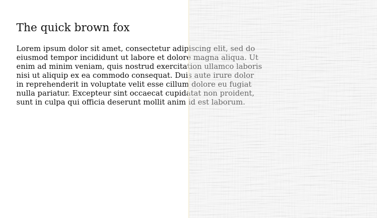
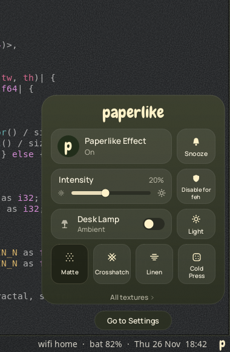

# paperlike

Paper and fabric textures for your Linux desktop.

paperlike lays a subtle texture over every screen to take the edge off glare
and harsh contrast, a bit like a matte screen protector in software. It
doesn't tint your colours the way night-light tools do, and it works
alongside them.

It's written in Rust for X11 and was built with i3 in mind, but any
window manager with a compositor should work. It was inspired by
[Paperman](https://paperman.cc/), which doesn't have a Linux version.



<sub>Left of the line: no texture. Right: Matte at its default 20%. Open the
image at full size to see the grain.</sub>

<p>
  
  
</p>

## Features

- **Ten textures**: Matte, Crosshatch, Parchment, Linen, Cold Press,
  Rice Paper, Frost, Felt, Graphite and Coarse Matte. Most have separate
  light-screen and dark-screen versions.
- **Light/dark switching** that can follow your GTK theme, what's actually
  on each monitor, or sunrise and sunset.
- **Intensity** remembered per texture and per theme.
- **Desk Lamp**: a warm glow from a corner or edge of the screen, with six
  presets and adjustable warmth, spread and dimming.
- **Snooze** for 1, 5, 10 or 15 minutes.
- **Gets out of the way** of fullscreen videos and games (only on the
  monitor they're on), and of screenshots taken with `paperlike hide`.
- **Per-app exceptions**: hide the texture in certain apps (say, GIMP or
  mpv), or only show it in certain apps.
- **Schedule**: always on, daytime, night-time or custom hours.
- **Battery saver**: pause on battery or below a charge level.
- **Multi-monitor**, with a per-monitor on/off switch. The grain is
  scaled to each monitor's pixel density so it looks the same size on a
  HiDPI laptop and a regular external screen.
- **Tray icon, control center and settings window**, plus global hotkeys
  and a command line for scripting and status bars.

It uses about 10 MB of memory and no CPU when idle. Each texture is rendered
once, on a background thread, and tiled by the X server, so nothing
repaints unless you change something.

## Requirements

- An X11 session (Wayland isn't supported).
- A compositor such as [picom](https://github.com/yshui/picom). Without
  one the overlay stays hidden, and if the compositor exits the overlay
  disappears straight away.
- Rust 1.88 or newer to build.

## Installing

Prebuilt binaries for x86_64 and ARM64 (glibc 2.35 or newer) are attached
to each GitHub release. Unpack one and put `paperlike` somewhere on your
`PATH`.

To build from source, clone this repository and run:

```sh
make install            # builds and installs to ~/.local
```

On Arch, `packaging/arch/PKGBUILD` builds a package from your checkout.

## Getting started

Start it from your i3 config:

```
exec --no-startup-id paperlike
```

The icon shows up in i3bar's tray (you need `tray_output` set for your bar).
Left-click opens the control center, right-click opens a menu, middle-click
toggles the texture and scrolling changes the intensity.

### Hotkeys

| Keys | Action |
| --- | --- |
| `Super+Alt+P` | Toggle the texture |
| `Super+Alt+T` | Next texture |
| `Super+Alt+O` | Toggle Desk Lamp |
| `Super+Alt+\` | Snooze for 5 minutes |
| `Super+Alt+]` / `[` | Intensity up / down |

You can change these in Settings › Hotkeys. You can also bind the command
line in i3 instead:

```
bindsym $mod+Mod1+t exec --no-startup-id paperlike next
```

### Command line

```
paperlike                     start, or open the control center if running
paperlike toggle | on | off
paperlike panel               toggle the control center
paperlike settings [page]     general, texture, lamp, schedule, exceptions,
                              display, hotkeys, about
paperlike next | prev
paperlike texture <name> [light|dark]
paperlike intensity <N|+N|-N>
paperlike lamp [on|off|toggle|<preset>]
paperlike snooze <minutes>|off
paperlike theme <light|dark|system|screen|sun>
paperlike hide -- <command>   hide the texture while a command runs
paperlike status [--json]
paperlike reload | quit
```

### Screenshots

Screenshot tools capture the texture too. `paperlike hide` hides it, runs a
command and brings it back when the command exits:

```
bindsym Print exec --no-startup-id paperlike hide -- maim ~/Pictures/screenshot.png
bindsym Shift+Print exec --no-startup-id paperlike hide -- maim -s ~/Pictures/screenshot.png
```

It waits for the command to finish, so use a tool that exits once the
picture is taken (`maim`, `scrot`, `import`) rather than one that hands the
work to a background process and returns straight away.

### Status bars

For an i3blocks block:

```ini
[paperlike]
command=paperlike status
interval=10
```

### picom

paperlike asks compositors not to draw a shadow under its overlay. If you
use blur, dimming or fading, exclude the overlay so they don't apply to the
whole screen:

```
# picom 12 and later
rules = (
  { match = "name = 'Paperlike overlay'"; shadow = false; blur-background = false;
    fade = false; dim = 0; corner-radius = 0; opacity = 1; },
);

# older versions
shadow-exclude          = [ "name = 'Paperlike overlay'" ];
blur-background-exclude = [ "name = 'Paperlike overlay'" ];
focus-exclude           = [ "name = 'Paperlike overlay'" ];
```

## Configuration

Settings live in `~/.config/paperlike/paperlike.toml`. The app saves them
whenever you change something, and edits you make to the file apply as soon
as you save it. If an edit doesn't parse, it's ignored (the error is printed)
and the current settings stay in place.

Everything is in the settings window except `ui_scale`, the size of the UI.
`0` (the default) works it out from `Xft.dpi`.

On HiDPI screens, try a grain scale of 1.5× or 2× (Settings › Texture, or
`grain_scale`). It applies to the main monitor; other monitors are matched
to it by pixel density unless that's switched off in Settings › Display
(`match_grain`).

## How it works

Each monitor gets a click-through, always-on-top ARGB window. The textures
are built from software versions of SVG filter primitives
(`feTurbulence` Perlin noise, `feDiffuseLighting` relief and linear-RGB
colour maths), so they look the same as the equivalent SVG in a browser.
See `src/svgfx.rs` and `src/texture.rs`.

## Building and hacking

```sh
cargo build --release
cargo test
cargo clippy --all-targets
tests/desktop.sh target/release/paperlike
```

`tests/desktop.sh` runs paperlike in a throwaway X session (it needs Xvfb,
i3, picom, xterm, xdotool, xwininfo and xrandr) and checks the overlay, the
tray icon, fullscreen hiding, `paperlike hide` and live config edits. CI
runs it on every push.

`paperlike preview <dir>` renders every texture into PPM files without
needing an X server, which is handy when working on textures.

## License

Licensed under either of [Apache License 2.0](LICENSE-APACHE) or
[MIT](LICENSE-MIT), at your option.

The bundled fonts keep their own licences: Manrope (SIL OFL 1.1) and Chewy
(Apache 2.0). Both are in `assets/fonts/`.

paperlike is not affiliated with Paperman or DoublOne Studios.
